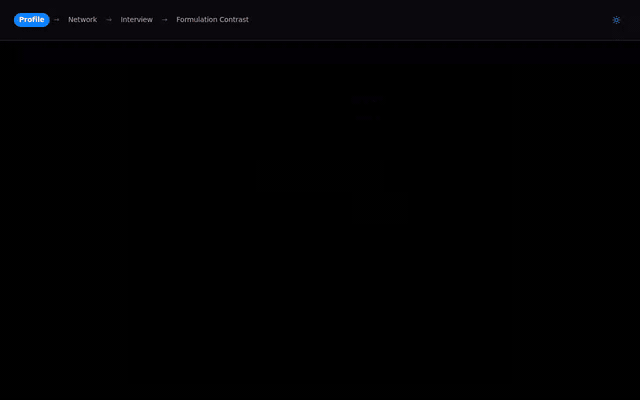
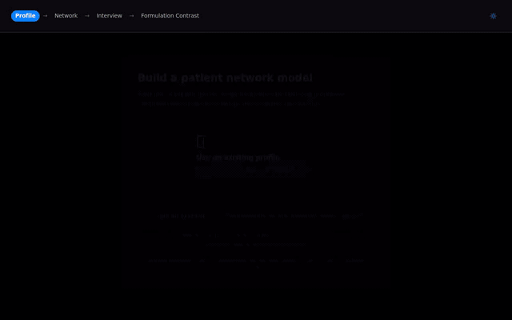
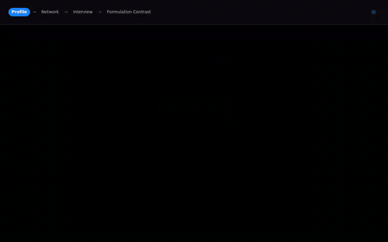
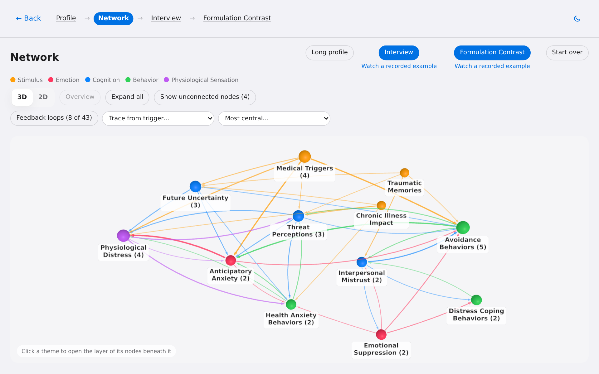
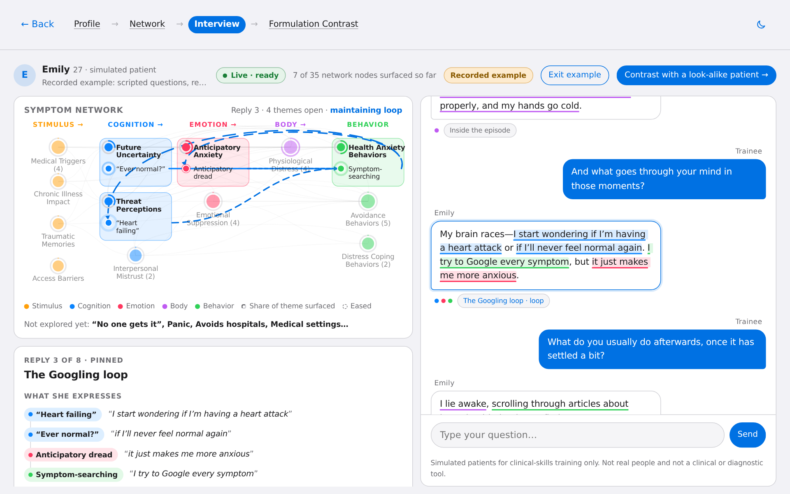
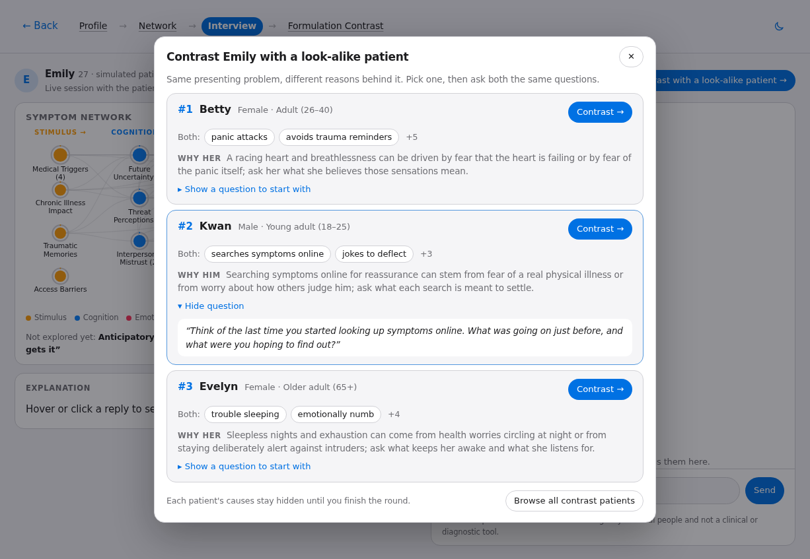
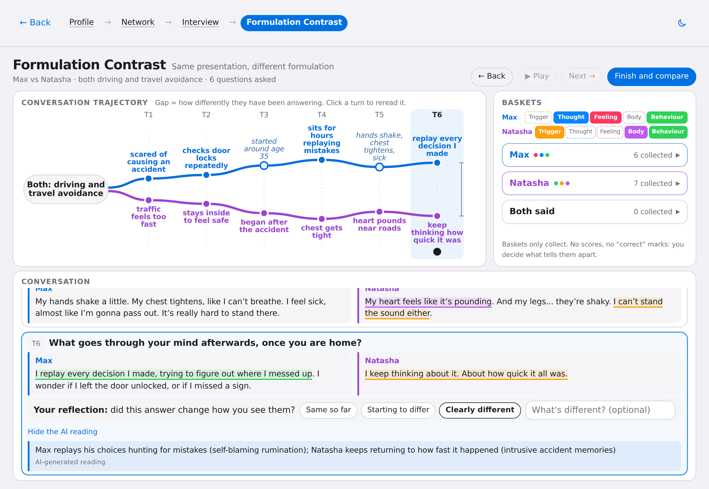
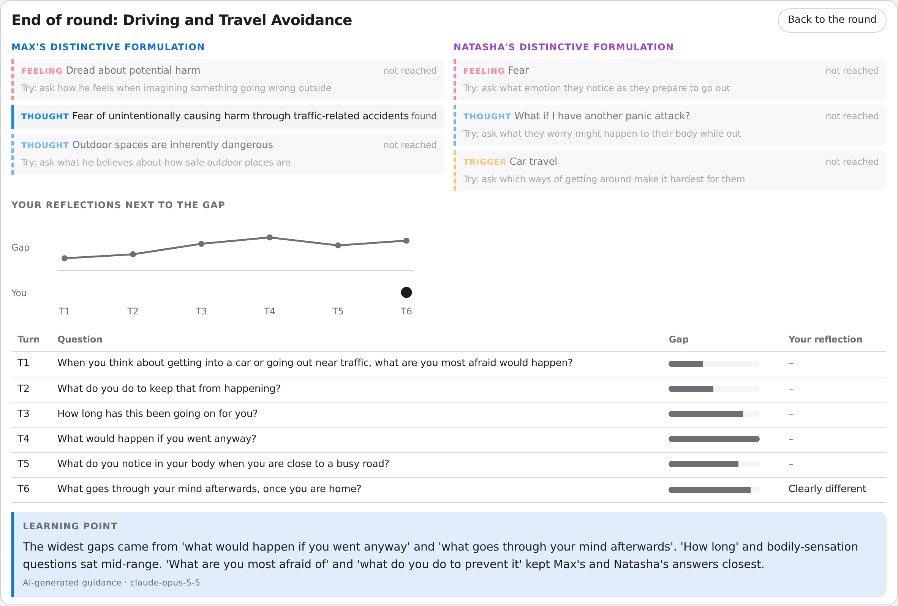

# PatientTrace

Interview a simulated mental-health patient and watch each reply being traced onto the patient's
symptom network; then pick a look-alike patient (same presenting problem, different reasons behind it)
and ask both the same questions to see where their formulations part ways.

| Network model | Interview | Formulation Contrast |
|:---:|:---:|:---:|
| [](docs/media/network.mp4) | [](docs/media/interview.mp4) | [](docs/media/contrast.mp4) |
| Each patient's symptom network in a layered 3D or a 2D view (27 s) | A recorded interview: each reply opens the themes it touches (32 s) | Two look-alike patients, the same questions, the gap between their answers (40 s) |

Short screencasts from the recorded examples (click a preview for the video).

| | |
|---|---|
|  **Network**: each patient's symptom network (triggers, thoughts, feelings, body, behaviours) in a 2D or layered 3D view. |  **Interview**: each reply is matched to the network; its themes open, the path it travels is drawn, and a panel explains what the reply shows. |
|  **Contrast picker**: ranked look-alike patients with the shared symptoms and why the pair is worth comparing (causes stay hidden). |  **Formulation Contrast**: the same questions to both; the gap between the tracks, baskets of what each revealed, the trainee's reflection, then an AI reading. |
|  **End of round**: each patient's distinctive causes (found / not reached, with a hint), reflections next to the gap, a learning point. | |

The demo runs in two modes:

| Mode | What works | Needs |
|---|---|---|
| **Browse / replay** | 330 patient profiles and their symptom networks, the contrast picker, recorded Interview examples (Emily, Leila) and recorded Formulation Contrast rounds (Max vs Natasha, Emily vs Evelyn) | Python 3.10+ only (no GPU, no API key) |
| **Live** | Everything above, plus live interviews with the patient model (streamed replies, traced as they arrive) and live Formulation Contrast rounds with any look-alike pair | One NVIDIA GPU for the patient model and an Anthropic API key |

Simulated patients for clinical-skills training only: not real people, and not a clinical or diagnostic tool.

## 1. Install

```bash
python -m venv .venv && source .venv/bin/activate
pip install git+https://github.com/Scarelette/PatientTrace.git
```

## 2. Get the patient data

The patient data (synthetic profiles, networks and recorded examples, about 5 MB) is a private
Hugging Face dataset. Use the access token given with the paper submission:

```bash
export HF_TOKEN=<access token from the submission>
patienttrace download-data         # unpacks into ~/.cache/patienttrace/data
```

To keep the data elsewhere, pass `--dest DIR` and set `PATIENTTRACE_DATA=DIR` before serving.
If you installed an earlier version, update the data too: `patienttrace download-data --force`.

## 3. Run

### Browse / replay mode

```bash
patienttrace serve
```

Open http://localhost:7860 and pick **Use an existing profile**. A guided path:

1. Choose **Emily** (or **Leila**): the Network page shows her symptom network.
2. Under **Interview**, click **Watch a recorded example**: the interview replays, each reply opening the
   network themes it touches. Hover or click a reply to see its explanation.
3. Under **Formulation Contrast**, click **Watch a recorded example** (Max vs Natasha): press **Play**, pick a
   reflection on a turn, open **Compare with an AI reading**, then **Finish and compare** for the reveal.
4. **Formulation Contrast** (the button) opens the contrast picker for the current patient; starting a round
   needs live mode.

### Live mode

Live mode adds the patient model ([ChengLi0228/Angel-Actor](https://huggingface.co/ChengLi0228/Angel-Actor),
Qwen3-8B, served with vLLM) and Claude for reply tracing and difference summaries.

```bash
pip install "patienttrace[gpu] @ git+https://github.com/Scarelette/PatientTrace.git"
export ANTHROPIC_API_KEY=...       # or put it in a .env file (see .env.example)
patienttrace serve --start-worker
```

The first start downloads the model (about 16 GB) and loads it. The page works right away, and
the first live reply arrives once the model is ready (`~/.cache/patienttrace/state/logs/worker.log`).

The model needs about 17 GB of GPU memory plus room for the cache; we ran it on an H200, and a
24 GB GPU should be enough. If the GPU is on another machine, start the worker there and point
the app at it:

```bash
# on the GPU machine
patienttrace worker --host 0.0.0.0 --port 7900
# on the machine that serves the page
patienttrace serve --worker-url http://<gpu-host>:7900
```

`patienttrace check` shows whether the data, the API key and the worker are found.

## Live mode on a Slurm cluster

The patient model runs as a Slurm job (`scripts/live_worker.slurm`, one large GPU while up; fill in `scripts/site.env` from `scripts/site.env.example`). Use
`scripts/live_mode.sh demo on 3` before a demo (keeps one worker for 3 h, resubmitted before its time limit by
a site watchdog running `scripts/worker_keepalive.py`), `scripts/live_mode.sh autostart on|off` to let a visitor's first live page start one
(rate-limited, daily cap), and `scripts/live_mode.sh status`. Details: [docs/LIVE_MODE.md](docs/LIVE_MODE.md).

## Configuration

| Variable | Default | Purpose |
|---|---|---|
| `ANTHROPIC_API_KEY` | – | Live tracing and difference summaries (Claude Opus 5.5) |
| `METHOD_MODEL` | `claude-opus-5-5` | Model for tracing and summaries |
| `PATIENTTRACE_DATA` | `~/.cache/patienttrace/data` | Patient data folder |
| `PATIENTTRACE_HOME` | `~/.cache/patienttrace/state` | Logs and response cache |
| `ANGEL_WORKER_URL` | – | Running worker (same as `--worker-url`) |
| `ROLEPLAY_MODEL_PATH` | `ChengLi0228/Angel-Actor` | Patient model (Hugging Face id or local folder) |
| `VLLM_GPU_MEM` | `0.85` | Share of GPU memory vLLM may use |

## Notes

- The patients are synthetic. The patient model is a research tool for training and studying
  clinical interviews, not a clinical or diagnostic tool.
- Live mode sends interview text to the Anthropic API.
- The app listens on `127.0.0.1` by default. Use `--host 0.0.0.0` only on a trusted network.

## Related

- Patient simulator and training code: [ANGEL-UserSim](https://github.com/Scarelette/ANGEL-UserSim)
- Models: [Angel-Actor](https://huggingface.co/ChengLi0228/Angel-Actor),
  [Angel-Observer](https://huggingface.co/ChengLi0228/Angel-Observer)

## License

Code: [Apache License 2.0](LICENSE). See the model cards for the models' terms.
